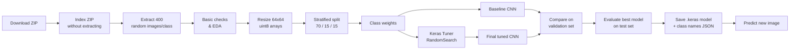

<div align="center">

# 🚦 Traffic Sign Recognition using Deep Learning (CNN)

### PRAICP-1002 · TrafSignDetc · Artificial Intelligence Capstone Project

*Classifying 43 types of traffic signs from camera images with a tuned Convolutional Neural Network*


</div>

---

## 📑 Table of Contents

1. [Project Overview](#-project-overview)
2. [Key Results](#-key-results)
3. [Project Metadata](#-project-metadata)
4. [Dataset](#-dataset)
5. [Pipeline Overview](#-pipeline-overview)
6. [Methodology](#-methodology)
7. [Model Architecture](#-model-architecture)
8. [Hyperparameter Tuning](#-hyperparameter-tuning)
9. [Results & Evaluation](#-results--evaluation)
10. [Repository Structure](#-repository-structure)
11. [Getting Started](#-getting-started)
12. [Usage: Predicting a New Image](#-usage-predicting-a-new-image)
13. [Configuration](#-configuration)
14. [Business Insights](#-business-insights)
15. [Challenges & Solutions](#-challenges--solutions)
16. [Limitations & Honest Notes](#-limitations--honest-notes)
17. [Future Work](#-future-work)
18. [Reproducibility](#-reproducibility)
19. [Project Links](#-project-links)
20. [Author & Acknowledgements](#-author--acknowledgements)

---

## 🎯 Project Overview

Traffic signs tell drivers what they **must do**, what they **must not do** and what **dangers lie ahead**. Missing or misreading a sign (a stop sign, a speed limit, a warning) is a common cause of road accidents. Driver-assistance systems and self-driving vehicles therefore need to recognise traffic signs automatically from camera images.

This project builds a **Convolutional Neural Network (CNN)** that looks at a photograph of a traffic sign and predicts **which of 43 sign classes** it is, together with a confidence score.

The DataMites project brief defines two goals, both fully covered in the notebook:

| # | Goal | How it is addressed |
|---|------|---------------------|
| 1 | **Image preprocessing** | Resize to 64×64, normalise to 0–1, stratified split, class weights, data augmentation |
| 2 | **ML model to predict the traffic sign** | Baseline CNN → Keras Tuner hyperparameter search → final tuned CNN, evaluated on unseen data |

---

## 🏆 Key Results

| Metric (Test Set, 2,319 unseen images) | Baseline CNN | **Final Tuned CNN** |
|---|:---:|:---:|
| Accuracy | 0.9935 | **0.9953** |
| Precision (macro) | 0.9941 | **0.9957** |
| Recall (macro) | 0.9939 | **0.9957** |
| F1-Score (macro) | 0.9940 | **0.9957** |

- ✅ **11 misclassified images out of 2,319** on the test set
- ✅ Model selected on **validation accuracy** (99.61%), so the test set never influenced any modelling decision
- ✅ Compact model: **780,971 parameters**, **9.4 MB** saved file – easy to deploy
- ✅ Saved model reloads with **identical predictions** (verified in the notebook)

---

## 🗂 Project Metadata

| Field | Value |
|---|---|
| **Project Title** | PRAICP-1002: TrafSignDetc – Traffic Sign Recognition |
| **Project Code** | PRAICP-1002 |
| **Project Type** | Artificial Intelligence Capstone Project |
| **Team Code** | PTID-AIE-JUL-26-11142 |
| **Dataset Source** | DataMites Capstone Project Dataset |
| **Dataset Name** | TrafSignDetc |
| **Submitted By** | Sameeksha |

---

## 📦 Dataset

| Property | Full Dataset | Working Subset (used) |
|---|---|---|
| Total images | 39,209 | 15,460 |
| Classes | 43 (folders `0`–`42`) | 43 |
| Smallest class | Class 0 – 210 images | Class 0 – 210 images |
| Largest class | Class 2 – 2,250 images | Class 1 – 400 images |
| Imbalance ratio (max/min) | **10.7 : 1** | **1.9 : 1** |
| File format / colour | PNG / RGB | PNG / RGB |
| Corrupt files | – | **0** |

**Image sizes:** from 25×25 up to 224×219 pixels, with **2,066 different resolutions** (median ≈ 44×43).

**Structure:** one directory per sign; the directory name is the class label.

```
Train/
├── 0/   -> Speed limit (20km/h)
├── 1/   -> Speed limit (30km/h)
├── ...
└── 42/  -> End of no passing by vehicles over 3.5 tons
```

**Download:** [PRAICP-1002-TrafSignDetc.zip](https://d3ilbtxij3aepc.cloudfront.net/projects/AI-Capstone-Projects/PRAICP-1002-TrafSignDetc.zip) (downloaded automatically by the notebook)

<details>
<summary><b>📋 Click to view all 43 classes</b></summary>

| ID | Sign | ID | Sign |
|:-:|---|:-:|---|
| 0 | Speed limit (20km/h) | 22 | Bumpy road |
| 1 | Speed limit (30km/h) | 23 | Slippery road |
| 2 | Speed limit (50km/h) | 24 | Road narrows on the right |
| 3 | Speed limit (60km/h) | 25 | Road work |
| 4 | Speed limit (70km/h) | 26 | Traffic signals |
| 5 | Speed limit (80km/h) | 27 | Pedestrians |
| 6 | End of speed limit (80km/h) | 28 | Children crossing |
| 7 | Speed limit (100km/h) | 29 | Bicycles crossing |
| 8 | Speed limit (120km/h) | 30 | Beware of ice/snow |
| 9 | No passing | 31 | Wild animals crossing |
| 10 | No passing for vehicles over 3.5 tons | 32 | End of all speed and passing limits |
| 11 | Right-of-way at next intersection | 33 | Turn right ahead |
| 12 | Priority road | 34 | Turn left ahead |
| 13 | Yield | 35 | Ahead only |
| 14 | Stop | 36 | Go straight or right |
| 15 | No vehicles | 37 | Go straight or left |
| 16 | Vehicles over 3.5 tons prohibited | 38 | Keep right |
| 17 | No entry | 39 | Keep left |
| 18 | General caution | 40 | Roundabout mandatory |
| 19 | Dangerous curve to the left | 41 | End of no passing |
| 20 | Dangerous curve to the right | 42 | End of no passing by vehicles over 3.5 tons |
| 21 | Double curve | | |

*The folders are numbered 0–42, matching the standard 43-class traffic sign numbering. The notebook falls back to folder names if they differ.*

</details>

---

## 🔄 Pipeline Overview



---

## 🔬 Methodology

### 1. Memory-Safe Data Loading
The full dataset is too large to hold in RAM on a laptop or free Colab session, so the notebook:
1. Downloads the ZIP once (skipped if already present).
2. **Reads the ZIP index without extracting** to count images per class (full-dataset EDA).
3. Extracts only a **random 400 images per class** (`MAX_IMAGES_PER_CLASS`) so every sign stays represented.
4. Stores images as compact **`uint8`** arrays (190 MB instead of 760 MB for `float32`).

### 2. Exploratory Data Analysis
Class distribution (full vs subset), image resolution histograms, one sample per sign and within-class variation galleries. Key findings:
- Strong imbalance in the full dataset (10.7 : 1)
- Many small images and many resolutions
- Large variation in brightness, blur, angle and background
- Look-alike classes (e.g. speed limits differ only by a number)

### 3. Image Preprocessing
| Step | Detail |
|---|---|
| **Resize** | RGB → **64 × 64** (array shape `64×64×3`) |
| **Normalise** | Divide by 255 via a `Rescaling(1/255)` layer **inside** the model, so new images are normalised identically at prediction time |
| **Reuse** | The same `preprocess_image()` function is used for training and for new images |

### 4. Train / Validation / Test Split (stratified)
| Set | Share | Images | Purpose |
|---|:-:|:-:|---|
| Training | 70% | 10,822 | Learning |
| Validation | 15% | 2,319 | Early stopping & hyperparameter / model selection |
| Test | 15% | 2,319 | Final, unbiased evaluation only |

**Class weights** (computed from training labels only, `balanced`) give small classes extra importance, e.g. classes 0, 19, 37 → **1.71**; classes 27, 32, 41, 42 → **1.50**.

### 5. Data Augmentation (training only)
| Transformation | Range | Real-world meaning |
|---|---|---|
| Rotation | ≈ ±11° | Tilted camera or sign |
| Translation | ±10% | Sign not centred |
| Zoom | ±10% | Sign nearer / farther |
| Contrast | ±20% | Sunlight, shade, dusk |

> ⚠️ **Horizontal flip is deliberately NOT used.** *Turn left / turn right*, *keep left / keep right* and *curve left / curve right* are mirror images; flipping would change the class label.

Augmentation layers sit at the start of the model and switch off automatically for validation, testing and prediction.

---

## 🧠 Model Architecture

**Baseline CNN** (688,747 parameters)

```
Input (64, 64, 3)
 └─ Data Augmentation (Rotation, Translation, Zoom, Contrast)   [training only]
 └─ Rescaling(1/255)
 └─ Conv2D(32, 3x3, ReLU)  → MaxPooling2D(2x2)
 └─ Conv2D(64, 3x3, ReLU)  → MaxPooling2D(2x2)
 └─ Conv2D(128, 3x3, ReLU) → MaxPooling2D(2x2)
 └─ Flatten
 └─ Dense(128, ReLU) → Dropout(0.5)
 └─ Dense(43, Softmax)
```

| Setting | Value |
|---|---|
| Optimiser | Adam (lr = 0.001) |
| Loss | Sparse categorical cross-entropy |
| Epochs / batch size | up to 30 / 32 |
| Callbacks | `EarlyStopping` (restore best weights), `ReduceLROnPlateau` (×0.5), `ModelCheckpoint` |

**Final Tuned CNN** (780,971 parameters, 2.98 MB) uses the same structure with hyperparameters chosen by Keras Tuner (below).

---

## 🎛 Hyperparameter Tuning

**Method:** Keras Tuner `RandomSearch` – 8 random trials (max 15 epochs each, early stopping patience 3), ranked by **validation accuracy**. Trying all 96 combinations would be too slow.

| Hyperparameter | Search space | **Best value** |
|---|---|:-:|
| Filters – conv layer 1 | 32, 64 | **32** |
| Filters – conv layer 2 | 64, 128 | **128** |
| Dense units | 128, 256 | **128** |
| Dropout | 0.3, 0.4, 0.5 | **0.4** |
| Learning rate | 0.001, 0.0001 | **0.001** |
| Batch size | 16, 32 | **16** |

- Best validation accuracy during search: **99.18%**
- Final model retrained from scratch for up to **40 epochs** (EarlyStopping patience 6)

---

## 📊 Results & Evaluation

### Model Comparison

| Model / Set | Accuracy | Precision (macro) | Recall (macro) | F1 (macro) |
|---|:-:|:-:|:-:|:-:|
| Baseline CNN – Validation | 0.9914 | 0.9920 | 0.9918 | 0.9918 |
| Baseline CNN – Test | 0.9935 | 0.9941 | 0.9939 | 0.9940 |
| Final Tuned CNN – Validation | **0.9961** | 0.9964 | 0.9960 | 0.9961 |
| **Final Tuned CNN – Test** | **0.9953** | **0.9957** | **0.9957** | **0.9957** |

Tuning improved validation accuracy from **99.14% → 99.61%**.

### Per-Sign Analysis
- **Weakest signs (F1):** 5 Speed limit 80 (0.97), 20 Dangerous curve right (0.98), 28 Children crossing (0.98), 11 Right-of-way (0.98), 7 Speed limit 100 (0.98)
- **Perfect signs (F1 = 1.00):** 38 Keep right, 35 Ahead only, 39 Keep left, 41 End of no passing, 42 End of no passing for vehicles over 3.5 tons
- **Most confused pairs:** Children crossing → Dangerous curve right; Speed limit 50 → 60; 70 → 30; 80 → 60; 80 ↔ 100; Right-of-way → Road work / Beware of ice-snow

### Demo Predictions (unseen test images)

| Actual | Predicted | Confidence |
|---|---|:-:|
| 29: Bicycles crossing | 29: Bicycles crossing | 100.0% |
| 21: Double curve | 21: Double curve | 99.9% |
| 28: Children crossing | 28: Children crossing | 100.0% |
| 11: Right-of-way at next intersection | 11: Right-of-way at next intersection | 100.0% |

### Visual Outputs
> 📌 *Add your exported figures to an `images/` folder and they will render here.*

| Class distribution | Sample signs |
|:-:|:-:|
|  |  |

| Training curves | Confusion matrix |
|:-:|:-:|
|  |  |

---

## 📁 Repository Structure

```
PRAICP-1002-Traffic-Sign-Detection-Using-Deep-Learning/
│
├── PRAICP_1002_TrafSignDetection.ipynb   # Main notebook (full pipeline)
├── TrafficSign_CNN_Model.keras           # Saved final model (9.4 MB)
├── TrafficSign_class_names.json          # Class folders, sign names, image size
├── requirements.txt                      # Python dependencies
├── README.md                             # This file
├── images/                               # Figures used in the README
└── reports/                              # PPT and project report (also on Google Drive)
```

> The dataset ZIP and the extracted `TrafSign_data_400/` folder are created by the notebook and should be excluded from version control (add them to `.gitignore`).

---

## 🚀 Getting Started

### Option A – Google Colab (recommended)
1. Open `PRAICP_1002_TrafSignDetection.ipynb` in Colab.
2. Run all cells. The first cell installs `keras-tuner`, `tensorboard`, `tqdm`; the dataset is downloaded automatically.

### Option B – Local machine

```bash
# 1. Clone
git clone https://github.com/Sameekshagithub/PRAICP-1002-Traffic-Sign-Detection-Using-Deep-Learning.git
cd PRAICP-1002-Traffic-Sign-Detection-Using-Deep-Learning

# 2. Create a virtual environment
python -m venv venv
source venv/bin/activate          # Windows: venv\Scripts\activate

# 3. Install dependencies
pip install -r requirements.txt

# 4. Launch
jupyter notebook PRAICP_1002_TrafSignDetection.ipynb
```

**`requirements.txt`**
```
tensorflow>=2.16
keras-tuner>=1.4
tensorboard
numpy
pandas
matplotlib
seaborn
scikit-learn
pillow
requests
tqdm
```

### ⏱ Approximate runtime (CPU only, no GPU)
| Stage | Time |
|---|---|
| Baseline training (30 epochs max) | ~25–40 min |
| Keras Tuner (8 trials) | ~2 h 26 min |
| Final model (40 epochs max) | ~1 h |

A GPU (e.g. Colab T4) reduces this substantially. For a quick dry-run set `MAX_IMAGES_PER_CLASS = 100`, `TUNER_TRIALS = 2`.

---

## 🔮 Usage: Predicting a New Image

```python
import json, numpy as np, tensorflow as tf
from PIL import Image

model = tf.keras.models.load_model("TrafficSign_CNN_Model.keras")
meta  = json.load(open("TrafficSign_class_names.json"))

def predict_sign(path, top_k=3):
    img = Image.open(path).convert("RGB").resize((meta["img_size"], meta["img_size"]), Image.LANCZOS)
    x = np.expand_dims(np.asarray(img, dtype=np.uint8), 0)   # normalisation happens inside the model
    probs = model.predict(x, verbose=0)[0]
    top = np.argsort(probs)[::-1][:top_k]
    return [(meta["class_folders"][i], float(probs[i])) for i in top]

print(predict_sign("my_sign.png"))
# e.g. [('14', 0.998), ('17', 0.001), ('13', 0.0004)]  -> class 14 = Stop
```

> **Important:** do **not** divide by 255 yourself – the `Rescaling` layer inside the model already does it. Class folder names are sorted as strings by the notebook; use `class_folders` from the JSON to map output indices back to class IDs.

---

## ⚙️ Configuration

Key switches near the top of the notebook:

| Variable | Default | Meaning |
|---|:-:|---|
| `MAX_IMAGES_PER_CLASS` | `400` | Images used per class. `None` = full dataset (needs more RAM); `100` = quick dry-run |
| `DELETE_ZIP_AFTER_EXTRACT` | `False` | Delete the large ZIP after extraction to save disk |
| `IMG_SIZE` | `64` | Input resolution |
| `SEED` | `42` | Random seed for repeatable results |
| `BASELINE_EPOCHS` / `BATCH_SIZE` | `30` / `32` | Baseline training |
| `TUNER_TRIALS` / `TUNER_EPOCHS` | `8` / `15` | Hyperparameter search size |
| `FINAL_EPOCHS` | `40` | Final model training |

---

## 💼 Business Insights

1. **Road safety & driver assistance** – alerts drivers to speed limits, stop signs and hazard warnings they may have missed.
2. **Foundation for autonomous vehicles** – a reliable sign classifier is a core building block; the pipeline can be reused when more data or a detection stage is added.
3. **Preprocessing enables real-world use** – identical resize/normalise steps at training and prediction time let one model handle photos from different cameras.
4. **Confusion analysis guides improvement** – look-alike signs (speed limits) are the best targets for collecting more varied photos; in a safety setting these errors matter more than confusing unrelated signs.
5. **Tuning adds measurable value** – the tuned model is openly compared with the baseline on the same data.

---

## 🧩 Challenges & Solutions

| Challenge | Solution |
|---|---|
| Dataset too large for memory | Read ZIP index without extracting; 400 random images/class; 64×64 size; `uint8` arrays; normalise inside the model |
| Many sizes and poor image quality | Convert everything to 64×64 RGB; add contrast augmentation |
| Class imbalance | Per-class sampling, stratified splits, class weights, macro-averaged metrics |
| Similar and mirror-image signs | No horizontal flipping; sign-by-sign confusion matrix and classification report |
| Overfitting | Augmentation, dropout, early stopping, learning-rate reduction |
| Information leakage in model selection | Hyperparameters and best model chosen on **validation** data only; test set used once at the end |

---

## ⚠️ Limitations & Honest Notes

- **Classification, not detection.** Despite the project title, the model classifies an already-cropped sign image. It does not locate signs in a full road scene.
- **Subset training.** Only 400 images per class (15,460 of 39,209) were used. Results on the full dataset may differ.
- **Possible near-duplicate leakage.** Datasets of this kind (the 43-class numbering matches the German GTSRB benchmark) typically contain several photos taken of the same physical sign as a vehicle approaches. A random image-level split can place near-identical frames in both train and test sets, which can make test accuracy look higher than real-world performance. A **group-aware split** (keeping all frames of one physical sign together, as indicated by the file-name pattern `classID_trackID_frameID`) would give a stricter estimate.
- **Validation-set ties.** Test accuracy of the tuned model (99.53%) is marginally below its validation accuracy (99.61%) – a normal, small difference, but it shows the two figures should not be over-interpreted at the decimal level.
- **Confidence ≠ correctness.** Softmax confidence is the model's own estimate and is not a guarantee.
- **Fixed conditions.** The model has not been tested on night-time, heavily occluded, damaged, or non-German-style signs.

---

## 🛣 Future Work

- [ ] Train on the **full 39,209-image dataset** (or use class-balanced oversampling)
- [ ] **Group-aware train/test split** to remove near-duplicate leakage
- [ ] **Transfer learning** (MobileNetV2 / EfficientNet / ResNet)
- [ ] Add a **detection stage** (YOLO / SSD) to find signs in full road scenes
- [ ] **Real-time camera** recognition and a web/mobile demo (Streamlit / Flask / TFLite)
- [ ] Targeted data collection for look-alike speed-limit classes
- [ ] Model compression / quantisation for embedded in-vehicle hardware
- [ ] Explainability with **Grad-CAM** heat-maps

---

## 🔁 Reproducibility

- Random seeds fixed: `random`, `numpy` and `tensorflow` all use `SEED = 42`
- Stratified splits with `random_state = 42`
- Environment used: **TensorFlow 2.21.0**, **Keras Tuner 1.4.8**, CPU-only run
- Saved model verified: reloaded model gives **identical predictions** (`np.allclose`, atol = 1e-5)

> Minor numerical differences can occur across hardware (CPU vs GPU) and TensorFlow versions.

---

## 🔗 Project Links

| Resource | Link |
|---|---|
| 🐙 **GitHub Repository** | https://github.com/Sameekshagithub/PRAICP-1002-Traffic-Sign-Detection-Using-Deep-Learning.git |
| 📂 **Google Drive (PPT & Report)** | https://drive.google.com/drive/folders/1pcADNaZ2l3gGNx7uDhTEBlcqMi5VIEOh?usp=drive_link |
| 📦 **Dataset** | https://d3ilbtxij3aepc.cloudfront.net/projects/AI-Capstone-Projects/PRAICP-1002-TrafSignDetc.zip |

---

## 👩‍💻 Author & Acknowledgements

**Sameeksha**
Team Code: `PTID-AIE-JUL-26-11142`

- **DataMites** – project brief and dataset (TrafSignDetc)
- **TensorFlow / Keras** and **Keras Tuner** teams
- **scikit-learn**, **NumPy**, **pandas**, **Matplotlib**, **Seaborn**, **Pillow**

<div align="center">

⭐ *If you found this project useful, consider giving the repository a star.* ⭐

</div>
